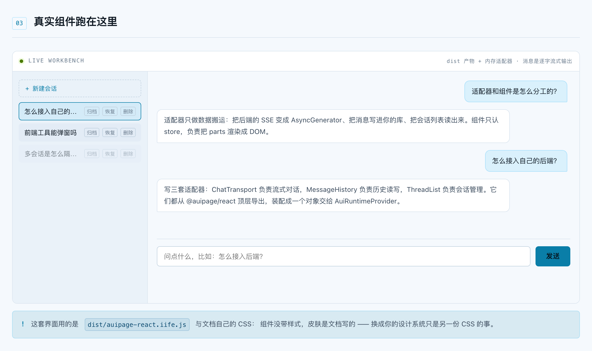

# @auipage/react

> 智能体页面的 React **无头（Headless）组件库**：消息流、会话列表、输入框的状态与交互归库，样式全部归你。

[](https://www.npmjs.com/package/@auipage/react)
[](https://github.com/handless-ui/auipage-react/blob/main/LICENSE)
[](https://www.npmjs.com/package/@auipage/react)



上图是文档站的在线 workbench：左侧会话列表、右侧消息流与输入区，全部由本库的组件 + 一份普通的 CSS 渲染，
消息是真实逐字流式输出（`dist/auipage-react.iife.js` + 内存适配器）。

## 它是什么

做智能体页面，难的不是气泡样式，而是这些：流式片段怎么拼、会话怎么切、工具调用怎么从「运行中」走到「结果」、
换一个模型后端要不要改界面。`@auipage/react` 把这些做成状态机，把样式全部留空。

| 取向 | 说明 |
| --- | --- |
| **Headless** | 组件只挂稳定的 `aui-*` class 与 `data-*` 属性，**不带任何 CSS**。 |
| **Adapter** | 三套适配器 `ChatTransport` / `MessageHistory` / `ThreadList` 把 HTTP、SSE、WebSocket 挡在外面。 |
| **Composition** | 没有几十个 props 的"智能组件"：消息用 render-prop 逐条渲染，工具卡片就是你自己写的 React 组件。 |
| **Type-safe** | 完整 `types/index.d.ts`，片段按 `part.type` 判别收窄。 |

## 提供什么

| 导出 | 类型 | 说明 |
| --- | --- | --- |
| `AuiRuntimeProvider` | 组件 | 装配 `AuiPage` + zustand store，向下提供 context |
| `ChatContent` | 组件树 | `Root` / `Viewport` / `Messages` / `Parts` + `Composer.{Root,Input,Send}` |
| `ThreadList` | 组件树 | `Root` / `New` / `Items` / `Item.{Root,Trigger,Title,Archive,UnArchive,Delete}` |
| `ChatTransportAdapter` 等 | 类 | 三套适配器，从 `@auipage/core` 透出 |
| `defineTool` | 函数 | 定义前端工具，`render` 是一个 React 组件 |
| `generator` | 工具函数 | 把回调式流读取包成 `AsyncGenerator` |
| `useAuiContext` 等 | Hook | 取 context / message / thread |

## 安装

```bash
npm install @auipage/react
```

依赖 `react ^18.3.1`、`@auipage/core ^0.1.0`、`zustand ^5.0.14`，无需引入任何 CSS。

## 最小接入

```tsx
import {
    AuiRuntimeProvider, ChatContent, ThreadList,
    ChatTransportAdapter, MessageHistoryAdapter, ThreadListAdapter
} from "@auipage/react";

// 1. 三套适配器，key 是约定死的
const adapter = {
    ChatTransport: new ChatTransportAdapter({
        async *run({ messages, context }) {
            yield { type: "text", text: "你好。" };
        },
        response(name, data) { /* 工具结果回传 */ },
    }),
    MessageHistory: new MessageHistoryAdapter({
        async load(threadId) { /* 历史消息组 */ },
        async append(threadId, group) { /* 落库 */ },
    }),
    ThreadList: new ThreadListAdapter({
        async list() { /* 会话列表 */ },
        async new(firstGroup) { /* 建会话 */ },
        async archive(id) { }, async unarchive(id) { }, async delete(id) { },
    }),
};

// 2. 挂 Provider + 搭界面
function App() {
    return (
        <AuiRuntimeProvider adapter={adapter} tools={[]}>
            <ThreadList.Root>
                <ThreadList.New>新建会话</ThreadList.New>
                <ThreadList.Items>
                    {({ thread }) => (
                        <ThreadList.Item.Root>
                            <ThreadList.Item.Trigger>
                                <ThreadList.Item.Title>{thread.title}</ThreadList.Item.Title>
                            </ThreadList.Item.Trigger>
                        </ThreadList.Item.Root>
                    )}
                </ThreadList.Items>
            </ThreadList.Root>

            <ChatContent.Root>
                <ChatContent.Viewport>
                    <ChatContent.Messages>{() => <ChatContent.Parts />}</ChatContent.Messages>
                </ChatContent.Viewport>
                <ChatContent.Composer.Root>
                    <ChatContent.Composer.Input />
                    <ChatContent.Composer.Send>发送</ChatContent.Composer.Send>
                </ChatContent.Composer.Root>
            </ChatContent.Root>
        </AuiRuntimeProvider>
    );
}
```

## 不打包，直接引用

```html
<script src="https://unpkg.com/react@18.3.1/umd/react.production.min.js"></script>
<script src="https://unpkg.com/react-dom@18.3.1/umd/react-dom.production.min.js"></script>
<script src="https://unpkg.com/@auipage/react@latest/dist/auipage-react.iife.js"></script>
<script>
    const { AuiRuntimeProvider, ChatContent, ThreadList } = AuipageReact;
</script>
```

IIFE 构建在加载时就把全局 `React` 当参数接收，**react 必须先于本库执行**；React 19 目前没有 UMD 构建，请锁 18。

## 版权

MIT License

Copyright (c) [zxl20070701](https://zxl20070701.github.io/notebook/home.html) 走一步，再走一步
